# 青笺 NotePad · 移动软件开发期中实验

> 记录每一个灵感，把想法、日常与计划留在这里。

青笺是在 Android 官方早期 NotePad 示例基础上扩展的本地记事本应用。本项目保留 **Java + SQLite + ContentProvider** 的原有结构，完成时间戳与笔记查询两项基本要求，并增加界面美化与 TXT 导出两项扩展功能。

**主要能力：** 标题与正文编辑 · 自动保存 · 修改时间展示 · 实时搜索 · 复制粘贴 · 删除确认 · UTF-8 文本导出。

## 目录

- [实验要求与完成情况](#实验要求与完成情况)
- [界面预览](#界面预览)
- [功能演示与操作说明](#功能演示与操作说明)
- [项目结构与数据流](#项目结构与数据流)
- [关键实现](#关键实现)
- [环境配置与运行](#环境配置与运行)
- [测试与验收](#测试与验收)
- [演示顺序与报告建议](#演示顺序与报告建议)
- [当前边界与后续扩展](#当前边界与后续扩展)

## 实验要求与完成情况

| 类型 | 实验要求 | 本项目实现 | 对应位置 |
| --- | --- | --- | --- |
| 基本要求一 | 笔记条目增加时间戳 | 显示最后修改时间，按修改时间倒序排列 | `NotesList.java`、`noteslist_item.xml` |
| 基本要求二 | 根据标题或内容查询 | 同一个搜索框同时检索标题与正文，输入后实时筛选 | `NotesList.java` |
| 扩展功能一 | UI 美化 | 青绿色主题、卡片条目、正文摘要、笔记数量、空状态、独立标题输入 | `res/layout/`、`styles.xml` |
| 扩展功能二 | 导出笔记 | 通过系统文件选择器导出包含标题、时间和正文的 UTF-8 TXT | `NoteEditor.java` |
| 基础功能 | 新建、编辑、删除、复制、粘贴 | 保留并修复操作入口，增加删除确认 | 两个主要 Activity、清单和菜单 |
| 使用体验 | 数据保存与页面恢复 | 离开编辑页时自动保存，内容不变不更新时间，重建页面复用笔记 URI | `NoteEditor.java` |

本次扩展复用已有的 `created`、`modified` 字段，未新增表，也未提高数据库版本。

## 界面预览

以下图片均为实际运行截图，使用专用 Android 模拟器和演示数据采集。示例标题与正文用于展示实验功能；截图中的时间取自该设备，应用实际按设备本地时区显示时间。

<table>
  <tr>
    <th>笔记首页</th>
    <th>笔记编辑</th>
    <th>正文检索</th>
  </tr>
  <tr>
    <td align="center">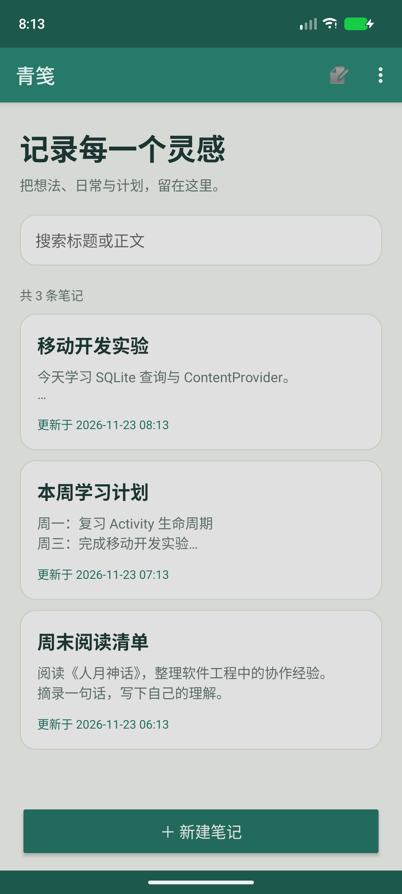</td>
    <td align="center">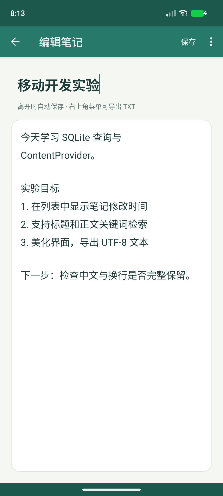</td>
    <td align="center">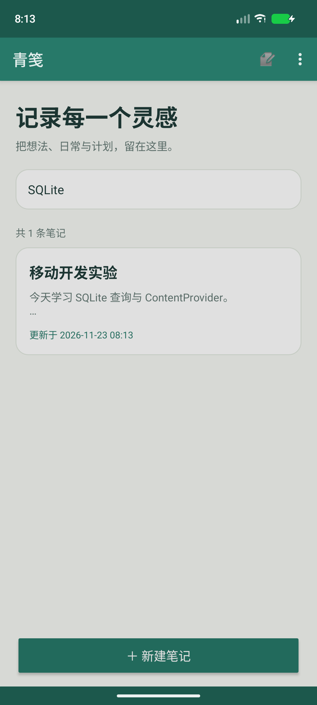</td>
  </tr>
</table>

## 功能演示与操作说明

### 1. 新建、编辑与自动保存

在首页点击底部 **“＋ 新建笔记”**，分别输入标题和正文。点击右上角“保存”可保存并返回；直接返回或切换页面也会触发自动保存。

- 标题留空、正文非空：自动采用正文首行，最多取 30 个字符。
- 只有标题：可以保存为一条笔记。
- 全空的新笔记：退出时丢弃，避免列表出现空记录。
- 打开已有笔记但没有修改：退出后保持原修改时间。
- “撤销未保存的修改”：恢复到最近一次保存的标题和正文；已经自动保存的版本不在撤销范围内。

<table>
  <tr><th>首次打开的空状态</th><th>编辑标题与正文</th></tr>
  <tr>
    <td align="center">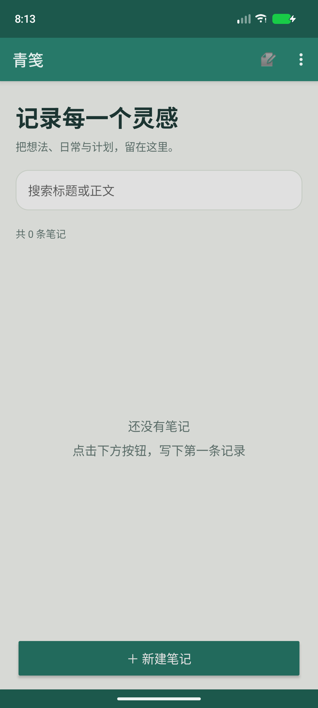</td>
    <td align="center"></td>
  </tr>
</table>

编辑页把标题、辅助说明和正文分开，正文支持多行输入与滚动。旋转屏幕等页面重建场景通过保存笔记 URI 恢复原记录，避免重新插入一条笔记。

### 2. 时间戳与列表排序

首页每条卡片包含 **标题 → 正文摘要 → 更新时间** 三个层次。时间采用 `yyyy-MM-dd HH:mm` 格式，列表按 `modified DESC, _id DESC` 排列，最近修改的笔记优先显示。


这里展示的是“最后修改时间”。创建时初始化时间；正文或标题实际发生变化时更新时间。仅打开后返回、导出未修改的笔记，都不会无故将记录移到列表顶部。

### 3. 按标题与正文搜索

在首页顶部输入关键词，即可同时匹配标题和正文。搜索结果仍保留摘要和时间，条数随结果更新；清空关键词后恢复全部笔记。

<table>
  <tr><th>标题命中</th><th>正文命中</th><th>没有结果</th></tr>
  <tr>
    <td align="center">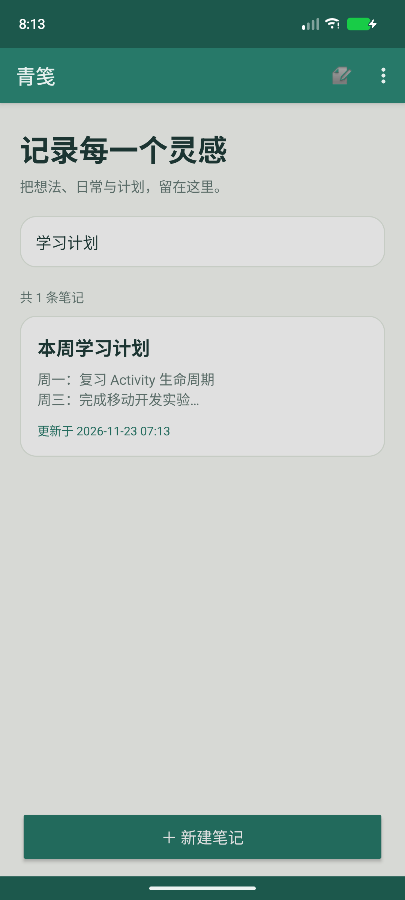</td>
    <td align="center"></td>
    <td align="center">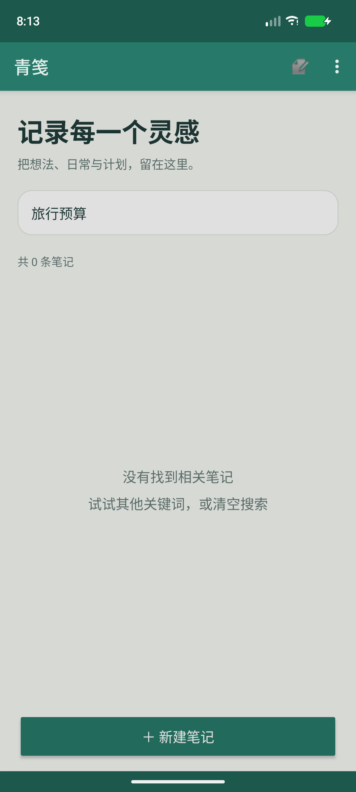</td>
  </tr>
</table>

本例中，“SQLite”没有出现在“移动开发实验”的标题里，但存在于正文中，因此依然命中。这一组截图可以直接用来说明实验要求中的“根据标题或内容查询”。

关键词通过查询参数传入，`%`、`_` 和反斜线经过转义后按普通字符搜索。例如搜索 `%` 时，只匹配实际包含百分号的笔记。

### 4. 复制、粘贴与删除确认

长按列表条目可打开上下文菜单，选择“打开”“复制笔记”或“删除”。复制后，在首页右上角菜单选择 **“粘贴为新笔记”**，创建包含原标题和正文的新记录；剪贴板中的普通文本也可粘贴为笔记。

<table>
  <tr><th>长按条目操作</th><th>删除前二次确认</th></tr>
  <tr>
    <td align="center">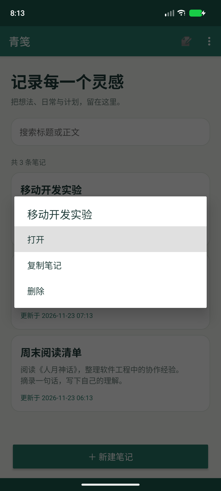</td>
    <td align="center">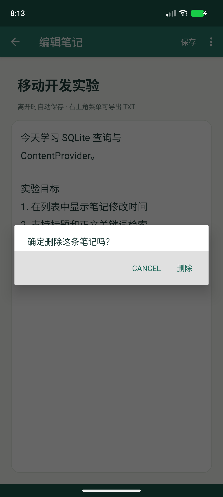</td>
  </tr>
</table>

编辑页菜单也提供删除入口。删除前需要确认，取消后保留笔记。适配新版 Android 时，复制选中的笔记 URI 使用临时授权，粘贴等编辑页获得焦点后读取剪贴板。

### 5. 导出为 TXT

打开笔记后，按以下步骤导出：

1. 点击右上角更多菜单，选择 **“导出为 TXT”**。
2. 在系统文件选择器中选择保存目录，确认文件名。
3. 点击系统的保存按钮，等待应用提示导出结果。
4. 使用文件管理器或文本编辑器打开 TXT，检查标题、修改时间、中文和换行。

<table>
  <tr><th>编辑页功能菜单</th><th>系统文件保存页面</th></tr>
  <tr>
    <td align="center">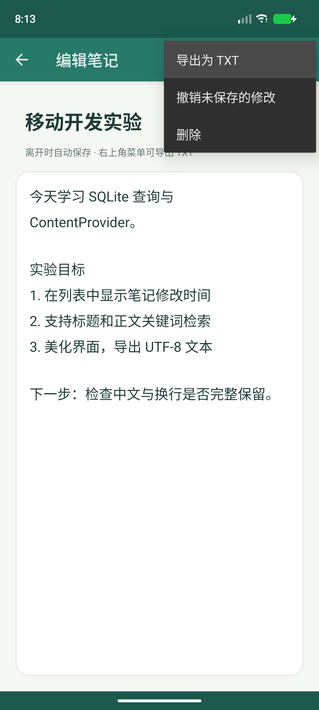</td>
    <td align="center">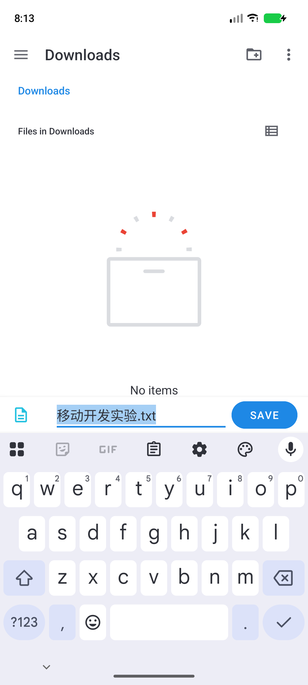</td>
  </tr>
</table>

导出内容为“标题 + 最后修改时间 + 空行 + 正文”，编码为 UTF-8。可查看本次实际导出得到的 [TXT 示例文件](docs/screenshots/export-example.txt)。导出先保存当前有效内容，再生成内容快照；取消文件选择只会取消导出。

```text
移动开发实验
更新于 <设备显示的最后修改时间>

今天学习 SQLite 查询与 ContentProvider。

实验目标
1. 在列表中显示笔记修改时间
2. 支持标题和正文关键词检索
3. 美化界面，导出 UTF-8 文本

下一步：检查中文与换行是否完整保留。
```

以上代码块用占位文字说明时间字段，TXT 链接中保留实际导出值。截图展示真实系统文件选择页面；随附示例文件通过测试指定保存目标后，调用应用实际导出逻辑生成。

## 项目结构与数据流

```text
app/src/main/
├── AndroidManifest.xml                # 页面入口、笔记操作与 Provider 注册
├── java/com/example/android/notepad/
│   ├── NotesList.java                 # 列表、搜索、时间绑定、长按操作
│   ├── NoteEditor.java                # 标题正文编辑、自动保存、TXT 导出
│   ├── NotePad.java                   # URI、列名和排序规则
│   ├── NotePadProvider.java           # SQLite 建表与增删改查
│   ├── TitleEditor.java               # 兼容原标题编辑入口
│   └── NotesLiveFolder.java           # 原示例的旧版动态文件夹入口
└── res/
    ├── layout/                        # 列表、条目、编辑页布局
    ├── menu/                          # 首页、编辑页、长按菜单
    ├── drawable/note_card.xml          # 卡片圆角、底色与边框
    └── values/                        # 中文文案、颜色与主题
```

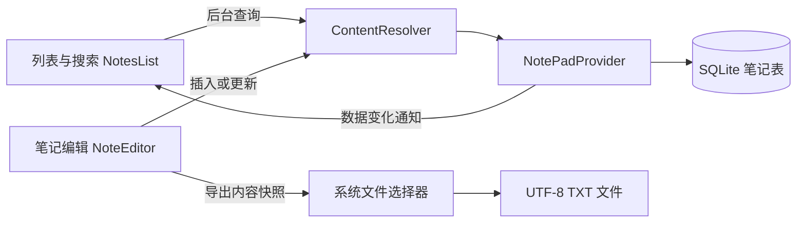

列表通过 `CursorLoader` 在后台查询数据，Provider 负责访问 SQLite。写入后 Provider 发出变化通知，Loader 重新加载，适配器更新列表。导出通过用户选择的目标 URI 写入文件。

## 关键实现

### 数据表与时间字段

沿用 `notes` 表：

| 列名 | 类型 | 作用 |
| --- | --- | --- |
| `_id` | INTEGER PRIMARY KEY | 唯一标识笔记，与单条笔记 URI 对应 |
| `title` | TEXT | 标题 |
| `note` | TEXT | 正文 |
| `created` | INTEGER | 创建时间，毫秒时间戳 |
| `modified` | INTEGER | 最后修改时间，毫秒时间戳 |

列表的 `PROJECTION` 加入 `modified`，在 `SimpleCursorAdapter.ViewBinder` 中把毫秒值格式化为可读日期。编辑页先对比当前内容与上次保存值，变化时才写入 `System.currentTimeMillis()`，从而保证更新时间反映实际编辑。

### 搜索与游标管理

搜索条件的核心形式：

```sql
(title LIKE ? ESCAPE '\' OR note LIKE ? ESCAPE '\')
```

两个参数均为转义后的 `%关键词%`。`TextWatcher` 监听输入变化，重启 `CursorLoader`；`onLoadFinished()` 使用 `swapCursor()` 更新适配器。查询与游标生命周期由 Loader 管理，避免每次输入都留下一个旧的受管游标。

### 编辑状态恢复

新建笔记时先插入记录并取得 URI，后续保存更新同一记录。`onSaveInstanceState()` 保留 URI、新建状态、待处理粘贴状态和导出快照；标题与正文视图拥有固定 ID，由系统恢复输入状态。页面重建后复用 URI，不再次创建记录。

### 文件导出

导出流程使用 Android 的 Storage Access Framework：

```text
保存笔记 → 生成文本快照 → ACTION_CREATE_DOCUMENT
        → 用户选择目标 URI → 后台写入 UTF-8 → 显示成功或失败
```

采用 `text/plain` MIME 类型，文件名替换不可用字符并限制长度。使用 `ContentResolver.openOutputStream()` 配合 UTF-8 写入，支持用户选择的文件提供程序，不申请广泛的存储读写权限。后台线程负责文件写入，避免文件提供程序响应较慢时阻塞界面。

### 原项目入口修复

| 操作 | 接收页面与数据类型 |
| --- | --- |
| 查看、编辑已有笔记 | `NoteEditor`，单条笔记 MIME 类型 |
| 新建、粘贴笔记 | `NoteEditor`，笔记集合 MIME 类型 |
| 兼容原标题编辑操作 | `TitleEditor`，`EDIT_TITLE` action 与单条笔记 MIME 类型 |

修正了新建操作指向标题编辑页的配置。主要编辑页现在直接提供标题输入；原来的标题编辑入口仍保留，修改标题时也会更新时间。

## 环境配置与运行

| 项目 | 配置 |
| --- | --- |
| 开发语言 | Java |
| JDK | 17 |
| Gradle | 8.13 |
| Android Gradle Plugin | 8.1.0 |
| compileSdk / targetSdk | 34 / 34 |
| Build Tools | 34.0.0 |
| 最低系统 | Android 5.0，API 21 |
| 数据存储 | 本地 SQLite + ContentProvider |

### Android Studio 运行

1. 打开项目根目录，等待 Gradle 同步。
2. 在 Gradle 设置中选择 JDK 17，确保安装 Android SDK Platform 34 与 Build Tools 34.0.0。
3. 检查 `local.properties` 中的 `sdk.dir`，填写自己的 SDK 目录。
4. 启动模拟器或连接开启 USB 调试的手机。
5. 选择 `app`，点击 Run，首次进入后新建一条笔记。

### 命令行构建

在项目根目录执行：

```powershell
.\gradlew.bat assembleDebug lintDebug
```

安装包输出到 `app/build/outputs/apk/debug/app-debug.apk`。有 Android 调试工具时，可执行：

```powershell
adb install -r app/build/outputs/apk/debug/app-debug.apk
```

如果出现 Java 版本问题，先检查 Gradle 使用的 JDK 是否为 17。构建插件可能提示 compileSdk 34 超出其已测试范围，这是工具版本兼容性提示，仍需以实际构建和检查结果为准。首次构建需要能够访问项目配置的依赖仓库。

## 测试与验收

### 已有功能测试记录

[ExperimentTest.java](app/src/androidTest/java/com/example/android/notepad/ExperimentTest.java) 使用 Android 测试框架，在真实 Activity、Loader 和 Provider 之间验证行为。已保存的 [原始测试记录](docs/test-results.txt) 来自 **2026-11-16** 的独立 API 37 模拟器验证：**7 项测试全部通过**。

| 测试方法 | 验证重点 |
| --- | --- |
| `testSearchTitleBodyLiteralWildcardsAndEmpty` | 标题、正文、特殊字符和无匹配结果 |
| `testSavingAndReopeningDoesNotChangeTimestamp` | 保存正文、保留创建时间、未修改不刷新修改时间 |
| `testNewNoteRecreationKeepsSingleRecord` | 页面重建后内容保留，只存在一条新记录 |
| `testExportWritesChineseAndLineBreaksAsUtf8` | 实际导出写入、UTF-8 中文、多行和特殊字符 |
| `testClipboardNotePasteKeepsTitleAndBody` | 从笔记 URI 复制粘贴后保留标题与正文 |
| `testBlankNewNoteIsDiscardedOnExit` | 空白新笔记退出后不增加记录数 |
| `testBodyOnlyNoteUsesFirstLineAsTitle` | 未输入标题时使用正文首行 |

导出自动测试拦截文件选择请求并返回测试位置，随后执行实际文件写入与内容核对；没有自动操作第三方云盘。页面重建测试调用 `recreate()` 验证恢复逻辑，实际设备的旋转体验仍可按下方步骤手动验收。

连接设备后执行：

```powershell
.\gradlew.bat connectedDebugAndroidTest -Pandroid.testInstrumentationRunnerArguments.class=com.example.android.notepad.ExperimentTest
```

### 手动验收清单

- [ ] 新建标题与正文，返回后内容保留，更新时间可读。
- [ ] 仅打开已有笔记并返回，修改时间不变。
- [ ] 输入仅存在于标题的关键词，可以命中。
- [ ] 输入仅存在于正文的关键词，可以命中。
- [ ] 输入不存在的词，显示无结果；清空后恢复全部列表。
- [ ] 长按复制，使用“粘贴为新笔记”得到同内容的新记录。
- [ ] 删除时先取消，笔记仍存在；确认后条目消失。
- [ ] 导出 TXT，检查中文、标题、时间和换行。
- [ ] 编辑期间旋转屏幕，输入保留且不重复创建记录。
- [ ] 关闭并重新打开应用，已保存内容仍存在。

本次 README 更新于 **2026-11-23**，新增各功能的实际截图与导出样例；业务功能测试的日期与原始记录分开标注。

## 演示顺序与报告建议

建议用下面的顺序完成课堂展示，让每个操作都有明确的验收点：

| 顺序 | 展示操作 | 对应实验要点 |
| --- | --- | --- |
| 1 | 打开首页，展示卡片、摘要和时间 | UI 美化、时间戳 |
| 2 | 新建“移动开发实验”，输入多行正文并保存 | 数据插入与编辑 |
| 3 | 搜索“学习计划”，再搜索正文中的“SQLite” | 标题与正文查询 |
| 4 | 输入不存在的词，再清空搜索 | 空状态与恢复 |
| 5 | 修改正文后返回，比较更新时间 | 时间戳更新语义 |
| 6 | 展示长按菜单、复制粘贴和删除取消 | 原有功能完善 |
| 7 | 导出 TXT，并打开文件核对中文与换行 | 导出扩展 |
| 8 | 旋转编辑页、重启应用检查数据 | 页面恢复与持久化 |

实验报告可以按 **实验目标 → 原项目结构 → 数据模型 → 两项基本功能 → 两项扩展功能 → 测试过程 → 结果与改进** 组织。截图应配上“操作、预期结果、实际结果”，不要只贴图片而不解释。

## 当前边界与后续扩展

- 当前实现面向本地文本笔记，TXT 导出不等于云备份或可恢复的数据库备份。
- 自动保存发生在编辑页离开时，没有逐键保存、版本历史或回收站。
- 时间显示精确到分钟，因此同一分钟内修改，界面文字可能相同；底层仍保存毫秒时间戳。
- 当前搜索使用 SQLite `LIKE`，适合实验规模；大量数据时可考虑全文索引、搜索防抖与分页。
- 保留了原示例的旧版动态文件夹代码，现代 Android 的主要演示范围是列表、编辑、搜索与导出。
- 本次没有触发数据库升级。原示例 `onUpgrade()` 使用删表重建，后续增加分类、待办等字段时应改成保留数据的迁移。

可继续扩展笔记分类、待办勾选、主题偏好、备份恢复和图片笔记；扩展时应为数据兼容与权限交互补充相应验证。

## 项目来源

本项目基于课程提供的 NotePad 示例扩展，源文件保留 Android Open Source Project 的版权和 Apache License 2.0 许可声明。

- 原始项目：`fjnu-cse/NotePad`
- 本次实现：时间戳、搜索、UI 美化、TXT 导出与相关兼容性修复。
